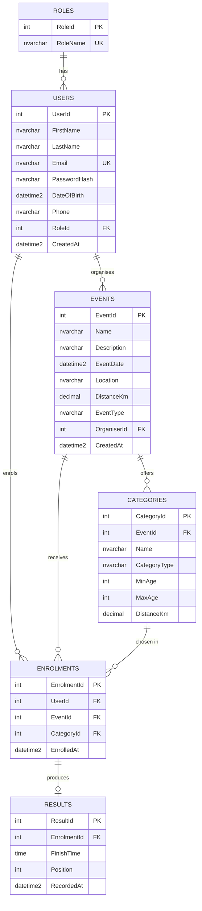

# RaceDay ERD (text version)

The diagram is in `RaceDay_ERD.png`. The same model as a Mermaid diagram:

| Relationship | Cardinality | Notes |
|---|---|---|
| Roles -> Users | one-to-many | A role has many users; each user has one role |
| Users (Organiser) -> Events | one-to-many | `Events.OrganiserId` |
| Events -> Categories | one-to-many | Deleting an event deletes its categories |
| Users (Participant) <-> Events | many-to-many | Resolved by `Enrolments` (UNIQUE `UserId, EventId`) |
| Categories -> Enrolments | one-to-many | The category chosen when entering |
| Enrolments -> Results | one-to-one | `Results.EnrolmentId` is UNIQUE |
